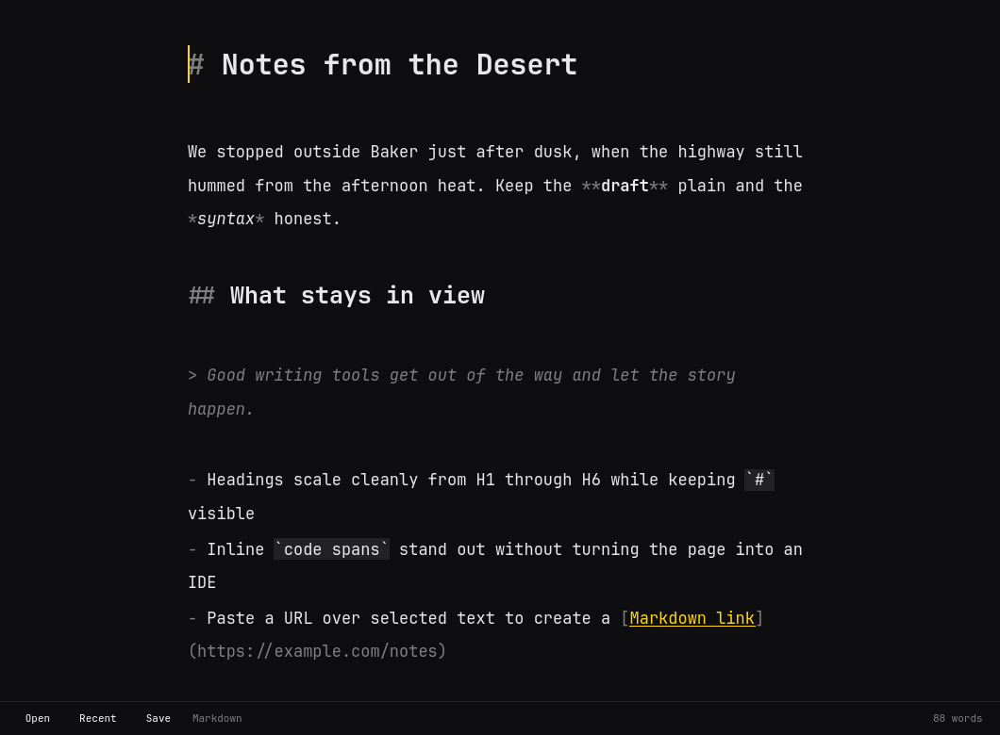

# Gonzo



A native Omarchy Markdown writing app ported from [henrrrik/gonzo-mac](https://github.com/henrrrik/gonzo-mac), inspired by [Omawrite](https://github.com/omacom/omawrite), and named for Hunter S. Thompson's gonzo journalism: get out of the way and let the story happen.

Built with C++17, Qt 6, and Qt Quick (`QGuiApplication`), compiled with `qmake6` and `make` into a single binary with no network access.

## Features

- Opens and saves UTF-8 `.md`, `.markdown`, `.mdown`, and plain text files up to 16 MB (stripping UTF-8 BOM, following symlinks, and rejecting special files without blocking).
- Styles headings (H1–H6 scale), bold, italic, blockquotes, links, and inline code while keeping Markdown syntax visible and dimmed.
- Centered 65-character writing column using the system monospace font, adjustable from 12pt to 32pt, with smooth kinetic scrolling for both mouse wheels and precision Wayland trackpads.
- Live Omarchy theming (`colors.toml` dark/light mode, palette, and accent) plus Hyprland corner rounding.
- Live Omarchy language switching (`~/.config/omarchy/language`) with CLDR plural word counts and right-to-left layout mirroring.
- O(log n) incremental word count and paragraph boundary tracking via an implicit treap (`TextMetrics`).
- Safe atomic saves with SHA-256 external-change conflict protection, 10-second autosave for saved files, and crash draft recovery that preserves the original file's baseline.
- Find and replace, single-step undo for formatting and smart newlines, recent documents, XDG portal file picker and printing (plain monospace Markdown source), and optional Hunspell spell checking (skipping inline code and link URLs).

Return inserts a paragraph break (`\n\n`), continues lists and blockquotes, and exits an empty list item. Shift+Return inserts a single line break. Backspace removes a `\n\n` paragraph break in one press. Pasting a valid URL over selected text creates a Markdown link.

## Shortcuts

| Shortcut | Action |
| --- | --- |
| `Ctrl+N` | New window |
| `Ctrl+O` / `Ctrl+Shift+O` | Open / Recent documents |
| `Ctrl+S` / `Ctrl+Shift+S` | Save / Save As |
| `Ctrl+P` | Print Markdown source |
| `Ctrl+F` / `Ctrl+H` (`Ctrl+Alt+F`) | Find / Find and Replace |
| `Ctrl+G` / `Ctrl+Shift+G` | Find next / previous |
| `Ctrl+E` | Use selection for find |
| `Ctrl+B` / `Ctrl+I` / `Ctrl+K` | Bold / Italic / Link |
| `Shift+Return` | Soft line break |
| `Ctrl+=` / `Ctrl+-` / `Ctrl+0` | Increase / decrease / reset text size |
| `Ctrl+Shift+;` | Toggle spell check |
| `F11` / `Super+F` | Toggle fullscreen |
| `Ctrl+?` / `Ctrl+/` / `F1` | Show keyboard shortcuts |
| `Ctrl+Q` / `Ctrl+W` | Quit / Close |

## Command Line

Headless commands run without a display server and support `--json`:

```sh
gonzo [file]                        # Open the editor (or start a new file)
gonzo open [file]                   # Explicit GUI open
gonzo stats [--json] <file>         # Word, paragraph, heading, link, and byte counts
gonzo check [--json] [--spell] <file>  # Validate UTF-8, 16 MB limit, and optional spelling
gonzo skill [install]               # Print or install the bundled agent skill
```

## Build, Test, and Install

```sh
./bin/build     # qmake6 + make into build/gonzo
./bin/test      # build and run Qt Test suite offscreen
./bin/install   # build and install Arch package via makepkg -fsi
```

## Scope

Syntax styling is deliberately lightweight and paragraph-local (paragraphs longer than 4,096 UTF-16 code units stay plain text; fenced code blocks are not styled). Printing outputs the plain monospace Markdown source.

See [LICENSE](LICENSE) for MIT license terms and attributions.
